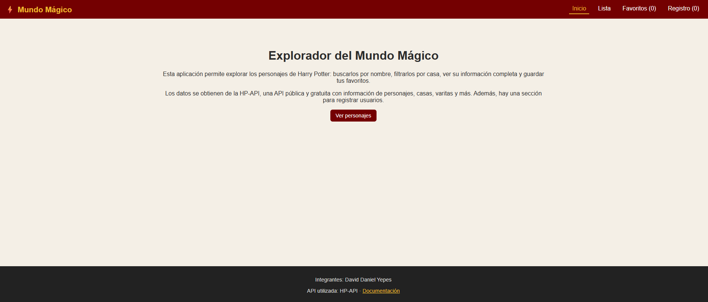
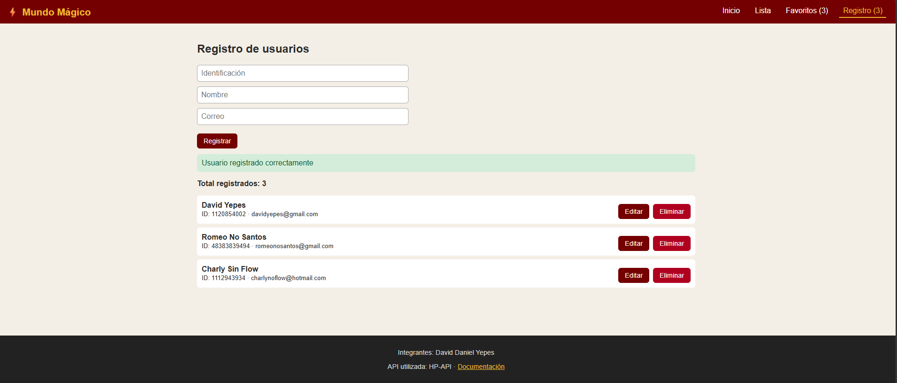

# Explorador del Mundo Mágico (Harry Potter)

Aplicación web hecha con React y Vite que permite explorar los personajes de Harry Potter,
guardarlos como favoritos y gestionar un registro de usuarios.

## API utilizada
- **Nombre:** HP-API
- **URL base:** https://hp-api.onrender.com/api
- **Endpoints usados:**
  - `/characters` (listado completo)
  - `/characters/house/{casa}` (filtro por casa)
  - `/character/{id}` (detalle)
- **Documentación:** https://hp-api.onrender.com

## Funcionalidades
- Listado con buscador por nombre, filtro por casa y botón "Cargar más"
- Detalle de cada personaje (ruta `/detalle/:id`)
- Favoritos guardados en localStorage
- Registro de usuarios (crear, listar, editar y eliminar) con validaciones
- Página 404 y diseño responsivo

## Cómo ejecutarla
```bash
npm install
npm run dev
```

## Capturas de pantalla

### Inicio


### Lista de personajes


### Detalle


### Favoritos


### Registro de usuarios


### Vista en celular


## Integrantes
- David Daniel Yepes
